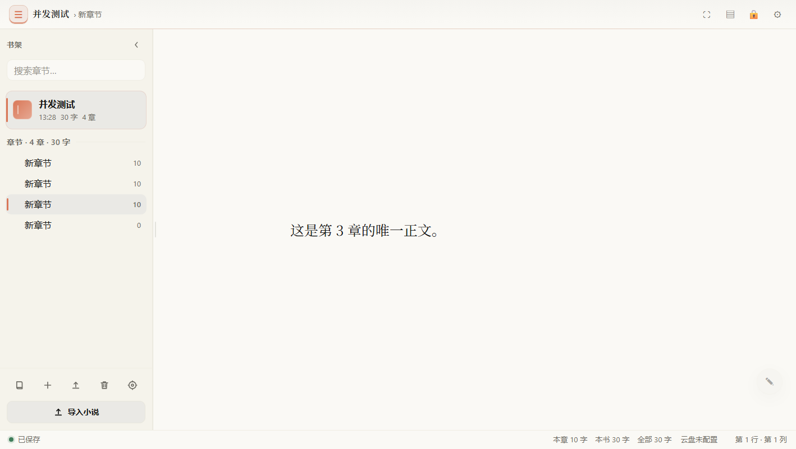
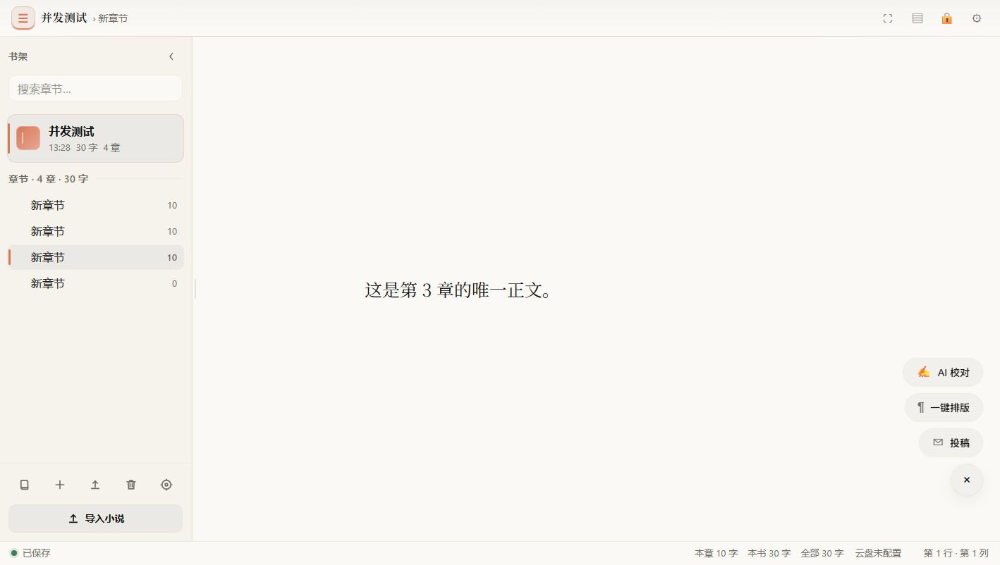
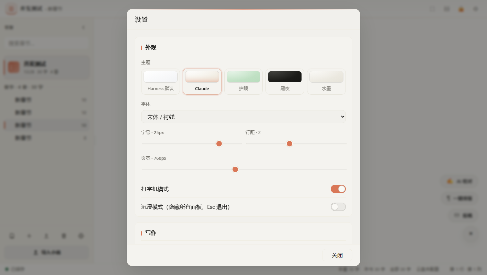
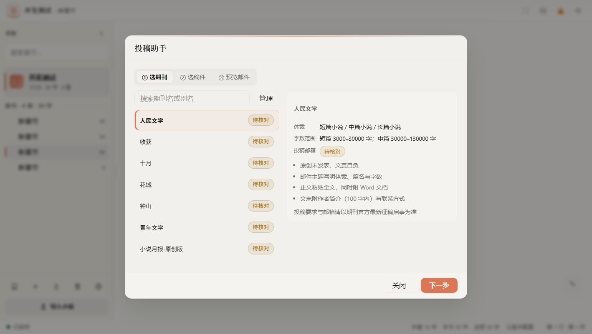
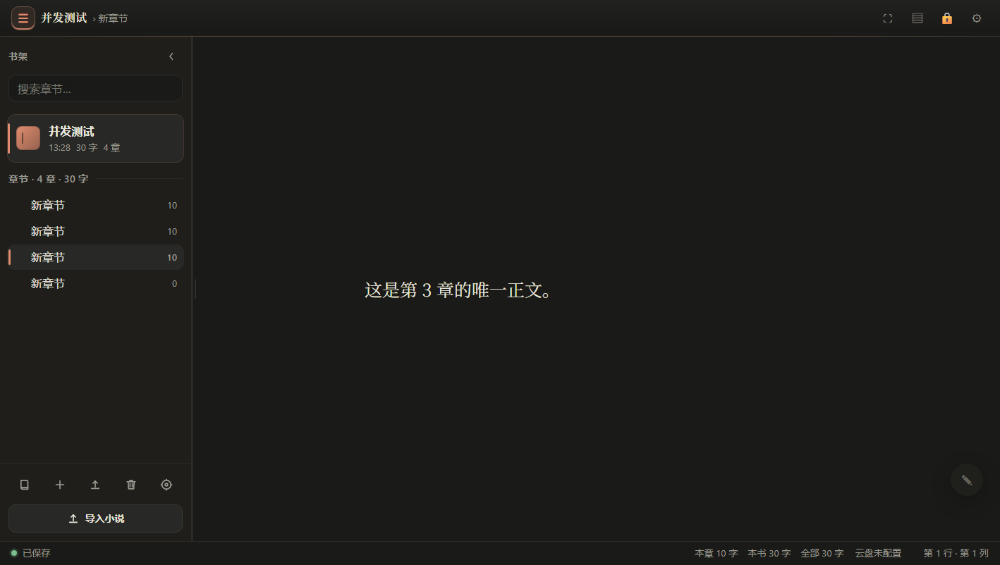

# 精神空间 · Mindspace

> 在 DeepSeek Harness 左侧栏里完成整部小说的写作、校对、排版、导出与投稿。

一个 DSH 双半插件（Host + Client）。左侧栏点书本图标进入 **中央面板**（不是右侧抽屉），
左目录 / 右编辑区的沉浸式布局，数据全部留在本机 IndexedDB。

- 包名：`@local/novel-writer` ｜ 版本：1.2.0 ｜ 入口：`index.js`（Host）+ `client/client.js`（浏览器）
- 依赖：**零运行时第三方依赖**（Host 只用 Node 内置模块，Client 只用宿主提供的 `react` 与主题 token）
- 第十二轮（R12）改造：写作页左上角新增**首页按钮**；新增**修改建议栏**——大模型通读本章后给出可
  点击定位的意见，面板与正文**左右并列**（不是弹窗）；投稿选定期刊后**直接生成整封邮件进预览**，
  不用再手动点「生成」；**收件箱邮件可点击阅读**（补零依赖 IMAP `BODY.PEEK[]` 取全文 + 读信弹窗）。
- 第十一轮（R11）改造：插件改名 **精神空间**；修首页「正在创作」点不进编辑页；修 163/126 收件箱
  `Unsafe Login`（补 RFC 2971 `ID` 握手）；**灵感便签改成纯色整页**；**光标可设置**（粗细/颜色/闪烁）；
  投稿邮件**不再复述期刊征稿要求**；**期刊库支持增删改查**；附带一键上传 GitHub 的脚本。
- 第五轮（R5）改造：删掉整条顶部工具栏、新增**欢迎首页**、主题扩到**八套**、设置改**左右两栏**、
  投稿向导改**四步**并带**智能推荐**、期刊库扩到 **79 家**、新增**投稿管理**、图标换成内联 SVG、
  SMTP 加**端口自愈矩阵**、**移除阿里云盘**。
- 第九轮（R9）改造：**删除整个云备份**（云端代码、面板、`lib/cloud.js` 全部移除），改成**选本地文件夹 +
  每次改动自动写加密文件 + 可从文件夹或单个 `.nwe` 备份恢复**；投稿向导重排为**选小说 → 选期刊 → 邮件预览**
  且预览页所有字段可改；新增**零依赖 IMAP 收件箱**（首页显示编辑部回信与未读）；新增
  `scripts/verify-client-load.mjs` 并把「bundle 能否被加载」接进构建闸门。
- 第十轮（R10）改造：保存与恢复**去重成一个面板**、落盘格式从 `.md` 换成 **`.docx`**、
  悬浮坞只留**三项写作动作**、新增**灵感便签**浮动栏（自动让出正文留白）、投稿附件改成**稿模式 docx 且可下载**、
  期刊补**按字数区间的多种收稿邮箱**、新增**杂志主题**（共九套）、**所有主题背景改纯色**（去掉方格纸纹）。

**入口速查**：侧栏顶部 = 首页 / 沉浸 / 宿主侧栏 / 锁定 / 设置 / 收起 · 目录底部 = 导入 ·
每本书/章行的「⋯」= 导出 · 右下 `✎` 坞 = AI 校对 / 一键排版 / 投稿 · 写作页右缘 `✦ 灵感` = 便签 ·
**自动保存**：设置 → 导出与文件 →「自动保存与恢复…」· **收件箱**：首页右上（设置 → 投稿里配 IMAP）。

| 主界面（Claude 主题） | 浮动坞展开 |
| --- | --- |
|  |  |

| 设置 | 投稿向导 |
| --- | --- |
|  |  |

| 沉浸模式（无顶栏，Esc 退出） | 黑夜主题 |
| --- | --- |
|  |  |

> 截图取自真实构建产物挂在自建宿主页（真 React + 活 Host API）的实拍，不是设计稿。
> **注意**：这批截图拍于 R5/R9，工具栏、浮动坞（R10 只剩三项）、主题数量（R10 为九套）与保存面板
> （R9 起改为「自动保存与恢复」）都已有变化，以本文文字说明为准。

---

## 1. 安装

插件包目录即本仓库根。在 DSH 里执行：

```
plugin_manager action=install_bundle target=C:\Users\17737\Desktop\dsh\编码区\novel-writer
```

安装后：

- 入口为 entryId `include:novel-writer`（`list_plugins` 可查），状态应为 `enabled:true` / `fiberPhase:"active"`；
- 左侧栏出现书本图标（order 5，位于插件与市场之间），点击切到「精神空间」主面板；
- 校验 Host 是否就绪（**Web 端口每次启动都会变**，用 `dsh web` 打印的端口或桌面版实际端口）：

```
GET http://127.0.0.1:<web端口>/novel-writer/api/ping
→ {"ok":true,"data":{"name":"novel-writer","version":"1.2.0","capabilities":{...}}}
```

> 包名仍是 `novel-writer`（`@local/novel-writer`、entryId `include:novel-writer`、API 前缀 `/novel-writer/api`），
> 只有**显示名**改成了「精神空间」。改包名会让已安装的 profile 指向一个不存在的目录，得不偿失。

> 若浏览器里点「AI 校对 / 云备份」报 405，说明 Host 的 HTTP 路由没注册成功（旧版在 web 宿主上
> mount 时机过早读不到 `webServer`）。本版 `index.js` 用 `ctx.inject(['webServer'], …)` 延迟注册，
> 405 已消除；升级后请**重载插件并刷新页面**（浏览器可能还缓存着旧 bundle）。

**改动 Host 代码后必须重载插件**（Node 模块已缓存，热改文件不生效）：

```
plugin_manager action=set_plugin target=include:novel-writer enabled=false
plugin_manager action=set_plugin target=include:novel-writer enabled=true
```

只改客户端代码则重建产物即可，浏览器刷新后生效：

```
node scripts/build-client.mjs      # client/src/*.js → client/client.js
node --check client/client.js
```

`build-client.mjs` 结束前会自动跑一次 **加载闸门**（`scripts/verify-client-load.mjs`）：用假的
`window.__ModuleLoader__` + 只解析 `react` 的 `require` 把产物整个 eval 一遍，断言导出了
`inject: ["slots"]` 与 `apply`。**语法检查抓不到的「反引号提前闭合模板字符串」只有这道闸门能拦住** ——
CSS 是用模板字符串写的，注释里多写一个反引号就会让整块样式变成语法错误。

### 上传到 GitHub（R11 附带）

本机没有全局安装 git / gh，所以工具是**便携版**放在 `.tools/`（已被 `.gitignore` 忽略，不进仓库）：

- `.tools/git/` — PortableGit 2.56（`git.exe`）
- `.tools/gh-token.txt` — 你的 GitHub Token（同样被忽略，**永远不要提交**）

**手动步骤只有一个**：双击仓库根目录的 **`setup-github.cmd`**，按提示粘贴一次 Token。

脚本会：`git init -b main` + 提交 → 用 Token 调 `api.github.com` 建仓库 → 逐个上传被 git 跟踪的文件
（blobs → tree → commit → ref）→ 打印仓库地址。**无需管理员权限，不改系统环境变量，不装任何东西到系统目录。**

> ⚠️ 为什么不用 `git push`：这台机器到 `github.com` 的连接是间歇性的（`api.github.com` 一直正常，
> 但 `github.com/login/device/code` 会成片超时）。`git push` 和浏览器 OAuth 都要访问 `github.com`，
> 所以随机失败。`tools/publish-github.mjs` 改走 REST API，**完全不碰 `github.com`**，只访问
> `api.github.com`，结果与 push 等价（同样的 tree/commit）。每个请求自带重试。
>
> Token 只需要 `repo` 权限：打开 https://github.com/settings/tokens/new?scopes=repo&description=mindspace
> 生成 classic token，粘进脚本即可。想换仓库名就改 `setup-github.cmd` 里的 `REPO=`。

也可以完全不跑脚本，用 GitHub 网页「Upload files」把这个目录（除 `.tools/`）传上去。


---

## 2. 功能

### 布局与外壳
- 单窗口左右分栏：左侧目录、右侧写作面，中间分隔条可拖拽（220–640px）、方向键微调 ±16px、双击复位 272px，宽度记忆在 localStorage。
- **没有顶部工具栏**（R5 删除）：写作面从面板最顶端开始，只剩侧栏头和底部状态栏。
- **目录可隐藏**：侧栏 topbar 最右的 `‹`，或写作区左缘常驻的 `›目录` 把手（目录隐藏后它才出现，键盘 `Ctrl/Cmd + \` 同样有效）。
  状态记在 `localStorage['nw.shelfOpen']`；隐藏后写作面占满宽度。
- **进入面板时自动收起宿主左侧栏**（`layout.toggleSidebar()`，用 `sessionStorage` 做一次性守卫）；侧栏头 `▥` 随时切回，并给出「已收起 / 已展开宿主左侧栏」的 toast。
- 底部状态栏一行显示保存状态、保存时间、本章 / 本书 / 全部字数、自动保存状态、光标行列。

### 欢迎首页（R5 默认屏）
- 打开插件先到**首页**而不是上次的章节：`view: 'home' | 'write'`，默认 `home`；选中章节 / 新建首章 / 进沉浸 / 点「继续写作」才切到 `write`。
- 四张卡：**正在创作**（最多 6 部，按最近更新排序，显示章节数 · 字数 · 日期）、**创作统计**（全书 / 本书 / 近 7 天 / 今天）、**投稿记录**（最多 5 条，状态徽章 + 距今 N 天）、**快捷入口**（继续写作 / 期刊库 / 投稿管理 / 设置）。
- 数据来自 `submit.record` 与 `journals.list`，任一失败都静默降级为空态；投稿成功后会主动刷新。
- **首页不画下划线**（R11）：`.nw-link` 在这页是嵌在正文里的行内按钮，一条常驻底线会被看成断裂的边框，
  所以首页统一用品牌色 + hover 下划线表达可点。编辑页与对话框里的锚点样式不受影响。

### 侧栏顶部与右下坞
侧栏 topbar 六个图标：`⌂` 首页 · `⛶` 沉浸 · `▥` 宿主侧栏 · `🔒` 锁定 · `⚙` 设置 · `‹` 收起目录。
浮动坞 `.nw-dock`（`right:20px; bottom:56px`）默认半透明（`opacity:.35`），hover / 键盘聚焦时完全显现；展开后只有四项写作动作：
`AI 校对 / 一键排版 / 修改建议 / 投稿`。首页、主题、打字机、锁定、设置这类入口都在设置面板或侧栏里，坞不再扮演第二个工具栏（R10 精简）。
写作面通过 `--nw-gutter-x` 自动让出右侧 ≥88px，文本块仍然居中，浮层不压正文。
「修改建议」在正文**右侧另开一列**而不是浮在文字上，所以它占的是布局宽度、不是留白——正文列会相应收窄，不会被挡住。

### 沉浸模式
`⛶` 或 `Esc` 进出（进入时 toast 提示「按 Esc 退出」）。**没有任何顶栏**：工具栏、目录、分隔条、状态栏、浮动坞全部卸载，只剩满屏写作面。
页宽放宽到 `max(页宽, 880px)`、上下留白 96px，并自动打开打字机模式；`Esc` 只退出沉浸、不动正文。

### 九套主题（默认 Claude）
| id | 名称 | 纸面 | 墨色 | 强调 | 形态语言 |
| --- | --- | --- | --- | --- | --- |
| `claude` | Claude（默认） | `#faf9f5` | `#141413` | `#d97757` | 圆角 12 / 10 / 16 |
| `harness` | Harness 默认 | 跟随宿主 | 跟随宿主 | 跟随宿主 | 跟随宿主 |
| `card` | 极简卡片 | `#ffffff` | `#17181a` | `#3b6ea5` | 圆角 16、无描边靠阴影、无衬线 |
| `eye` | 护眼 | `#cce8cf` | `#1f2a20` | `#2f6b3c` | 同 Claude |
| `night` | 黑夜 | `#1a1a18` | `#e8e6dc` | `#e08d6f` | 同 Claude，深色 |
| `ink` | 水墨 | `#f4f2ec` | `#1a1a18` | `#2b2b28` | 同 Claude |
| `newspaper` | 报纸 | `#f2eee2` | `#1c1b17` | `#8c2b22` | 圆角 2、全衬线、标题 small-caps、2px 分隔线 |
| `magazine` | 杂志（R10） | `#ffffff` | `#14171a` | `#d0021b` 编辑红 | 圆角 14、无衬线界面 + 衬线正文、小节标题下 2px 红条、激活动作红条 |
| `guofeng` | 国风 | `#f5f1e6` | `#23211b` | `#a8442f` | 圆角 8、楷体正文 + 宋体界面、主按钮朱砂印 |

主题**同时接管整个外壳**（侧栏 / 对话框 / 状态栏 / 浮动坞 / 首页），不是只染正文：`client/src/98-shell-theme.js`
在 `.nw-root[data-theme=…]` 作用域内重映射 `--dsw-alias-*`，并顺手改圆角与字体族，插件内所有颜色都从这层派生，宿主自身 chrome 不受影响。
`harness` 不写任何重映射分支，就是宿主原色。旧主题 id 自动迁移：`light→claude`、`dark→night`、`parchment→ink`。
**背景一律纯色**（R10）：早期两套主题的纸纹用两向 `repeating-linear-gradient` 叠出方格，已全部改回 `--nw-texture:none`。

### 图标
全部内联 SVG（`client/src/42-icons.js`，`NW.icon(name, {size, weight})`）：16×16 viewBox、`stroke:currentColor`、
stroke 1.5、圆头圆角，60 个名字覆盖新建 / 编辑 / 导航 / 上传下载 / 写作工具 / 状态。不再出现 `☰ ▢ ⛶ ⚙ 🔒 ✍ ¶ ✉ ×` 这类文本字形，
因此不会因宿主字体缺失变豆腐块，换主题时只跟着 `color` 变。

### 视觉语言
- Claude 设计语言：16px UI 基准 / 14px 次级 / 13px 小字 / 1.55 行高；圆角 卡片 12 / 控件 10 / 模态 16 / 胶囊 999；按钮 36px、图标按钮 34px、输入 38px、工具栏 52px、状态栏 34px；间距 8 / 10 / 12 / 16 / 20 / 24。
- 层叠背景由前景墨色 `color-mix` 派生（宿主浅色 layer token 全是纯白，直接映射会让层次完全看不见）。
- 输入控件统一 2px 品牌焦点环；卡片 hover 抬升 1px；激活动作左侧 3px 品牌强调条；细滚动条。
- 动效由 `96-motion.js` 统一发布：`nw-fade-up`（对话框/折叠区升起）、`nw-toast-in`、`nw-slide`、`nw-pop`（浮动菜单/坞展开）、按钮 `:active` 0.97 缩放，时长 `--nw-dur: .18s`。
- `prefers-reduced-motion: reduce` 下所有动画与位移归零。

### 目录
- 小说 → 章节（含嵌套子章节）两层树，深度优先顺序持久化；行高 36px、缩进 14px/级、层级连接线。
- 新建 / 重命名 / 删除（进回收站）/ 拖拽排序（HTML5 DnD，2px 插入线）/ 搜索（300ms 防抖，命中正文关键词）。
- 每项显示名称、更新时间（当天 `HH:mm`、当年 `MM-DD`、跨年 `YYYY-MM-DD`）、字数；小说卡带 28×28 渐变小封面。
- 每行 hover 出现「⋯」菜单：导出 / 重命名 / 删除；底部五个 40×40 图标按钮（新建小说 / 新建章节 / 导入 / 回收站 / 设置）+ 一条整宽「导入小说」。
- 新建小说自动创建首章；点章节即切换，切换前 `flush()` 强制落盘。

### 编辑器
- 纯文本 / Markdown 源文编辑，三层叠放（高亮镜像层 + 粗光标层 + 透明 textarea），不引入富文本 contenteditable。
- **首页按钮（R12 ①）**：纸张左上角常驻一枚半透明胶囊（`⌂ 首页`，`opacity .55` → hover 1），一键回到欢迎首页。
  它是必需的而不是装饰：沉浸模式下侧栏与工具栏都会被卸载，没有它就只能靠 Esc 退出再找入口；
  文字页上的按钮在沉浸态进一步降到 `opacity .28`，不抢注意力。
- **加粗加黑光标**：`caret-color: transparent` + 绝对定位 `.nw-cursor`（默认 `--nw-caret-width: 3px`、高 = 1.2em、墨色 `--nw-caret-color` 近黑 `#0f0f0e`），位置复用同一套 `measureCaret()` 测量，`translate3d` 只在位置变化时写；有选区 / 输入法组合中 / 窗口失焦时自动隐藏；1.06s `step-end` 闪烁，切换两个等价 keyframes 重启闪烁且零 reflow。
- **光标可设置（R11）**：设置 →「外观」里有三项 —— **粗细**（1–8px 滑块，默认 3px）、**颜色**（取色器 + 文本框，留空表示跟随主题；九套主题各自有一份默认墨色）、**闪烁**（开关，关掉后 `data-caret-blink="0"` 让 `animation: none`）。
  实现细节：粗细/颜色写进 `.nw-surface` 的 CSS 变量，闪烁写 `data-*` 属性而**不写内联 style** —— 因为 `paintCaret()` 每帧会改写 `animationName` 来重启闪烁周期，内联值会被它悄悄打开。
- 自动保存（默认 1200ms 防抖，可配 200–60000ms），失焦 / Ctrl+S / 切章 / 卸载 / `beforeunload` 立即保存。
- 输入路径：零 setState + rAF 合帧 + read→write 两阶段；`measureCaret` 只增量改写一个 textNode；`spellCheck`/`autoCorrect`/`autoCapitalize` 全关；`.nw-stack` 加 `contain: layout style`。（R2 同步 200 字实测 0.36–0.8ms/字。）
- 字号默认 **20px**、行距 **2.0**、页宽 **760px**；老默认值（17 / 1.9 / 720，以及 R2 过渡期的 19）一次性迁移到新默认，用户自选值不动。
- 字体（宋体 / 黑体 / 楷体 / 思源宋体 / 系统等）、字号、行距、页宽实时可调。
- **打字机模式**：镜像测量光标真实视觉行并滚到视口垂直中央（实测 `dist = −19px` 恒定，等于半行高；容差 ±40px）。滚动容器三路探测（`.nw-scroll` → overflow 祖先 → `document.scrollingElement`），窗口级 passive scroll 兜底，容器身份变化自动重算；手动滚轮 / 触摸 / 方向键 / PgUp/PgDn / Home/End 触发 800ms 抑制窗。
- 快捷键：`Ctrl/Cmd+B` 加粗、`Ctrl/Cmd+I` 斜体、`Ctrl/Cmd+S` 保存、`Ctrl/Cmd+F` 查找替换、`Tab` 两个全角缩进、`Esc` 关闭浮层 / 退出沉浸、`Ctrl/Cmd+Shift+L` 锁定。

### 导入 / 导出
- 导入 `txt` / `md` / `markdown` / `docx` / `epub`：自动识别章节标题切分，保留书名与作者；中文 txt 非 UTF-8 时回落 GB18030。入口在目录底部。
- 导出 `docx` / `pdf` / `epub` / `txt`：入口在书 / 章行的「⋯」菜单，可只导当前章或整本。
  - docx：A4（11906×16838 twips）、宋体 **14pt**（四号，接近期刊通行的「小四/四号」）、首行缩进 560 twips、
    1.5 倍行距（投稿附件 1.75 倍）、Heading 1 18pt、页脚 PAGE 域。
    标题与作者居中排在第一页顶部，**其下直接接正文**（不单独起标题页、不留空白页）。
  - epub：EPUB 3，`mimetype` 首条且不压缩，含 container / OPF / nav / toc.ncx。
  - pdf：优先 Harness `officeToPdf`；不可用时回退内置 `libreoffice-kit`。
- **文末追加固定内容**：设置 →「写作」里写一段「文末追加内容」并开「导出时追加」，或在导出对话框里对单次导出临时更改。
  内容 ≤ 8000 字，Host 侧按格式插入（docx 独立段落 / epub 新增 `<p>` / txt 末尾空行后）。
- 导出选项：封面、章节间分页、生成目录、包含书名与作者；「包含书名与作者」的默认值在设置里。

### AI 校对与一键排版
- 可选任意 Harness 已配置 provider 与模型（`llm.listProviders()` + `listModels()`，默认取当前 agent 默认模型）。
  下拉永远有选项：若当前默认模型不在 `listModels()` 返回里（部分 provider 不暴露列表），会把它作为「（当前默认）」补进第一项。
- 校对按 4000 字分块串行请求，定位方式为「模型返回原文 → `indexOf` 对齐 + 块偏移」，并用 `text.slice(start,end)===original` 二次校验，对不齐的建议直接丢弃。
- **注意**：`llm.stream()` 不能传顶层 `system` 字段（宿主 pi 适配器会对字符串 `content` 调 `.some(...)` 崩溃）。本插件把系统提示词折进 user 消息的 text block。
- 建议逐条勾选，支持单条接受 / 拒绝 / 全部接受 / 全部拒绝；**先预览 diff 再应用**，`applyEdits` 从右往左写入，不覆盖未接受的原文。
- 一键排版：统一省略号与破折号、中英文标点、引号、段落两字全角缩进、空行折叠、章节标题格式、对话分段。同样先出 diff 预览，`changed === 0` 时禁用应用。

### 修改建议栏（R12 ② 新增）
右下坞 `✦ 修改建议` 打开一块**与正文左右并列**的评论栏（`NW.Advice`，默认宽 336px，可拖宽 260–600px，
开关与宽度都记在 `localStorage`）。它不是替换工具，而是「第二读者」：

- 点「开始审读」后，Host 把当前章按 4000 字分块送模型（`lib/ai.js` 的 `revise()`），要求返回
  `{quote, issue, advice, kind}` 四元组，`kind` 限 节奏 / 用词 / 视角 / 画面 / 对话 五类，每章最多 8 条。
- 面板顶部一排「重点」分段控件（全部 / 节奏 / 用词 / 视角 / 画面 / 对话），换重点会重新审读。
- 每条建议显示「原句 → 问题 → 怎么改」；**点一条会把编辑器滚到那一段并高亮**（`setHighlights`），
  面板底部有「重新审读」与「取消高亮」。切章自动清空，避免建议引用屏幕上已经不在的文字。
- 定位方式与校对一致：模型给的 `quote` 用 `indexOf` 回原文对齐，对不齐的条目标「原文已改动，定位不到」，
  仍然显示意见但不做高亮——宁可少给一次跳转，也不跳到错的段落。

### 投稿助手（R8 三步 + 智能推荐，R12 直达预览）
右下坞 `✉ 投稿` 打开三步向导（`NW.dialogs.Submit`，宽 820px）：**先选小说 → 再选期刊 → 邮件预览**。
选定期刊点「下一步」就直接落到预览页：进入第 3 步的 effect 会立刻跑 `submit.prepare`，
模型按该刊征稿要求写好收件人、主题、正文与附件，作者只需要**审阅并改**，不用再点「生成」。

1. **① 选小说**：小说列表（默认选中当前正在写的那本），右侧列出各章字数；可按「整本 / 当前章 / 自定义勾选章节」定稿。
   换了小说，体裁推荐与邮箱判定都会跟着重算。
2. **② 选期刊**：期刊库 **79 家**（人民文学 / 收获 / 十月 / 花城 / 当代 / 钟山 / 作家 / 上海文学 / 天涯 /
   长江文艺 / 山花 / 芙蓉 / 江南 / 清明 / 北京文学 / 萌芽 / 西湖 …），其中 **58 家带公开收录的投稿邮箱**。
   顶部一条**智能推荐**（最多 6 家，纯规则打分：体裁命中 ±40、字数区间 +30、题材标签每条 +5、
   有邮箱 +12、纸刊 −15），每项显示得分理由。右侧详情同时列出**该刊登记的全部收稿邮箱**，
   命中的那一条标「本稿用这个」并带 `data-on` 高亮——这是 R10 补的，之前只看得到单一地址。
   **全部邮箱 `verified:false`**，界面上标「待核对」——请以期刊官方最新征稿启事为准。
3. **③ 邮件预览**：`submit.prepare` 由 Host 生成主题与正文、把稿件调整成期刊要求的格式，
   返回 `changes`（章标题 / 空行 / 标点 / 缩进逐条说明）与 `attachments`（按期刊要求生成的附件）。
   **收件人、主题、正文、附件名、署名全部可在这里改**，附件行给出「预览 / 下载 / 移除」，
   点「查看全文」以只读层展示完整邮件（不截断）。**这一步不会发信。**
4. 点「确认投稿」才真正 `submit.send`，随后写一条投稿记录（`submissions.json`，最近 50 条）。

- **邮件正文不复述征稿要求**（R11）：遵守要求体现在信本身（主题格式、附件数量与命名、是否粘贴正文），
  在正文里逐条抄录「贵刊要求：1…2…3…」会像模板群发，编辑一眼就能看出来。R11 删掉了
  `handleSubmitPrepare` 里「模型漏了哪条就补一条进正文」的逻辑，也把兜底信的
  「贵刊的征稿要求我已逐条对照」改写成一句「投稿前已按贵刊要求核对格式与字数」；
  `SUBMIT_SYSTEM_PROMPT` 里也加了一条硬约束禁止复述。
- **投稿附件是「稿件」而不是网页导出**（R10）：docx 走 `manuscript` 模式——页眉右对齐 `书名　·　作者：X`（楷体 9pt 灰）、
  正文行距放宽到 1.75 倍并在每章前分页，方便审稿人直接在纸上批注；附件行可下载与编辑部完全一致的字节。
- **安全阀**：只有 ≤ 4000 字才把正文交给模型调整；返回的章数必须一致、每章长度在 0.7×–1.4× 之间，否则丢弃改回纯规则排版；AI 不可用时自动退回规则排版并给出 warning。
- 未配置 SMTP 时点「确认投稿」会留在原页并提示「去配置邮箱」，不会真的发信失败。

### 投稿管理（R5 新增）
`NW.dialogs.SubmitManager`，入口在首页「快捷入口 → 投稿管理」。
按状态筛选（全部 / 已投稿 / 等待回复 / 已过稿 / 已退稿 / 已发表 / 已撤回），每行显示
**小说名 · 期刊 · 投稿日期 · 距今 N 天 · 状态徽章**，可原地改状态（`submit.update`，原子重写 `submissions.json`），
也可「重新投稿」——回填该期刊重新打开向导第 1 步。状态是本机记账，不会联网、不解析回信。

### 期刊库（R5 新增，R11 支持增删改查）
`NW.dialogs.Journals`，入口在首页「快捷入口 → 期刊库」。
79 行列表 + 搜索 + 「只看待核对」；每行显示名称、邮箱（未收录则写「未收录邮箱」）、字数区间与「已核对 / 待核对」徽章；
行内编辑邮箱 / 官网 / 字数区间 / 要求，保存时只写 delta，填了邮箱会自动置 `verified:true`。
内置条目的 `tags / subject 模板 / attachments / paperOnly / responseDays / minWords / maxWords` 也一并落库。

**R11 补齐了「增」和「删」**：
- **新增**：工具栏「新增期刊」→ 先填期刊名（其余字段同编辑表单），保存时由 `lib/journals.js` 的 `makeId()` 按名称生成 slug（重名自动加 `-2`），整条作为自定义条目落库。
- **删除**：行内「删除」按钮或编辑表单底部「删除这家期刊」，二次确认后写**墓碑**（`{id, deleted:true}`）。
  墓碑是必须的 —— 内置 79 家来自代码里的 `TABLE`，如果只是从 overrides 里移除，下一次 `merge()` 会把它们**复活**，
  用户会看到「删了又回来」。
- **改 / 查**：原有能力不变；自定义条目可改全部字段，内置条目只存与内置值不同的字段（`diffFromBuiltin`）。
- 多邮箱仍按「期刊 + 体裁 / 字数区间」分列，编辑器里一行一条：`邮箱 | 体裁 | 字数 | 备注`。

### 数据与隐私
IndexedDB `novel-writer` v2：`novels` / `chapters` / `versions` / `trash` / `settings` / `notes`（R10 新增灵感便签）。
- 自动保存 + 每章保留最近 50 个版本快照（60s 节流 + 手动「立即快照」）。
- 删除进回收站，可单条恢复或清空；删除小说连带其章节与版本。
- 备份：本地 JSON 全量导出 / 恢复（单事务 `clear + put`，失败回滚），恢复后编辑器自动重新载入。

**锁定与加密（两层）**：
- 浏览器内：PBKDF2-SHA256（210000 次）派生密钥，正文以 AES-256-GCM 逐段加密落盘（`enc:v1:` 前缀）。
- 有密码 + 冷密钥（刷新 / 重启 DSH）= 强制锁定，**不信任 localStorage 的解锁标记**。
- 存在密码但密钥已冷时，`saveChapterContent` 拒绝任何对密文的覆盖（明文、空串都拒），杜绝「解密失败 → 空串回写 → 正文永久清空」。
- 改密码 / 清密码前先 `decryptAll()` 用旧密钥还原，再重新加密或明文落盘；**改密码必须先验旧密码**（`NW.crypto.changePassword(old,next)`），旧密码错则零状态变更。设置面板是「当前密码 / 新密码 / 清除密码」三个独立输入框。
- 离开超时自动锁定（默认 15 分钟）、`Ctrl+Shift+L` 手动锁定。
- **磁盘镜像加密**：设置 →「自动保存与恢复」里打开「加密保存」，`library.mirror` 会写 `<书名>.docx.nwe` + `library.json.nwe`，
  格式 `NWENC1` + base64(`iv[12] || tag[16] || ciphertext`)，AES-256-GCM，密钥由 Host `secrets/key.bin` 经 **HKDF-SHA256**（info `novel-writer-mirror`）派生——派生密钥不落盘。
  「解密出明文副本」（`library.decryptTo`）可把 `.nwe` 还原成可读的 `.docx` / `.json`（默认输出到 `<dir>/plain`）。

**小说保存目录**：设置 →「导出与文件」里的入口打开「自动保存与恢复」面板，选一个本机文件夹（Windows 原生目录选择器，也可手输路径），
之后每次修改自动把每部小说覆盖成 `<书名>.docx`（加密时 `.docx.nwe`）+ 一份 `library.json` 全量快照。
路径与开关存在 `DSH_HOME/novel-writer/settings.json`（原子写）。

**密钥与 API Key**：Host 侧 `DSH_HOME/novel-writer/secrets/`，`key.bin`（32B，尝试 0600）+ `store.enc`（AES-256-GCM 信封），原子写入、写操作串行化、铸钥单飞，绝不硬编码、绝不明文落盘。

### 设置（左右两栏 · 六个分区）
左侧导航 + 右侧内容，右栏单独滚动（`max-height:min(62vh,560px)`），窗口 <640px 时导航折成可换行的胶囊行：
1. **外观**：九套主题色块、字体、字号、行距、页宽、打字机模式、沉浸模式。
2. **写作**：自动保存间隔、默认导出格式、文末追加内容与开关、导出包含书名与作者、封面入口、校对默认模型。
3. **导出与文件**：默认格式、版本历史，以及**一行的「自动保存与恢复」摘要 + 打开按钮**（R10 去重：具体控件只在那一个面板里）。
4. **隐私与锁定**：自动锁定、锁定超时、正文加密存储、密码设置 / 修改 / 清除。
5. **投稿**：**服务商预设胶囊**（QQ / 163 / 126 / Yeah / 新浪 / 阿里 / Gmail / Outlook / iCloud，一键填主机 + 端口 + SSL）、
   SMTP 主机 / 端口 / TLS / 用户名 / 密码 / 保存 / 测试连接；默认笔名、联系方式、回信邮箱；期刊库入口。
6. **快捷键**：完整键位表。

### 自动保存与恢复（R9/R10：本地文件夹 + 加密，云备份已删除）
- **云备份整块删除**：`lib/cloud.js`、`NW.cloud`、备份面板的 WebDAV / Gist / 文件夹三种后端全部移除。
  开启自动保存之后，小说本来就在你自己的硬盘上，再叠一层云端同步只是把同一份数据复制到别人的服务器。
- **只有一个入口，不再重复**（R10）：设置里的「导出与文件」只留一行摘要 + 一个「打开…」按钮，
  选目录 / 开关 / 保存 / 恢复全部收在 `NW.dialogs.Backup` 这一个面板里（标题「自动保存与恢复」）。
- **选一个文件夹，之后每次改动自动覆盖写入**：`library.pick()` 打开 Windows 原生目录选择器
  （回退到宿主 `uiWorkspace.pickDirectory()`），选定即视为开启自动保存。
- **落盘格式是 Word**（R10）：`<书名>.docx`（加密时 `<书名>.docx.nwe`）——A4、宋体 14pt、首行缩进、每章分页，
  编辑和审稿人双击就能打开；早期版本写的 `.md` 仍然能被列出与解密，只是不再新写。
- **默认加密**：写盘的是 `NWENC1` + base64(`iv[12] || tag[16] || ciphertext`)，AES-256-GCM，
  密钥由宿主 `secrets` 里的 `key.bin` 经 HKDF-SHA256 派生（info `novel-writer-mirror`）。密钥只在本机，拷走文件夹的人打不开。
- **快照是完整的**：`library.json[.nwe]` 里同时带 `novels` / `chapters` / `settings`，
  所以「从文件夹恢复」和「从单个备份文件恢复」都能还原书目 + 正文 + 偏好设置，而不只是书名列表。
- **两种恢复入口**：面板里的「从上面这个文件夹恢复…」，以及「从备份文件恢复」——后者接受任意
  `.nwe` / `.json`，客户端读成文本交给宿主 `library.restore({text, name})` 解密，不要求文件在保存目录里。
- **「解密出明文副本」是什么意思**：自动保存写出去的是**加密的** `.docx.nwe`（`NWENC1` 容器，AES-256-GCM），
  直接双击打不开 —— 这是有意的，别人拷走你的文件夹也读不到正文。按钮做的是「把加密的这批文件另存一份
  **不加密**的到 `<保存目录>/plain/`」，文件名还原成 `书名.docx` 与 `library.json`，可以直接用 Word 打开、
  发给编辑、或放进别的同步盘。**原件不动**：加密版继续留在外面，自动保存流程完全不受影响。
  换句话说，它是「另存为可读副本」，不是「关掉加密」。确认不再需要时，把 `plain/` 整个删掉即可；
  再次点按钮会重新生成一份最新的。
- 「解密出明文副本」把 `.nwe` 解成 `<dir>/plain/*.docx` 与 `library.json` 供备份或交给别的编辑器，原件保留。

### 灵感便签（R10 / R11 改为纯色整页）
写作页右侧常驻一枚小标签（`✦ 灵感`）。点开后是**一整页纯色写作面**：没有标题、没有计数、没有按钮，
只有一个通栏输入框，背景就是当前主题的纸色（跟随九套主题，纯色无纹理）。
- **怎么存**：`Ctrl/Cmd + Enter` 或点别处（失焦）即写回；`Esc` 收起。内容存在 IndexedDB 的 `notes` store，
  随书库一起进导出与文件夹备份。
- **一页一本书**：整页内容在打开时由该书的便签合并而成，保存时折回一条，所以下次打开看到的就是同一份文本，
  不会有列表、时间戳这些额外东西。
- **不再占正文留白**：R10 的浮动便签列会给正文让出 212px；改成整页后编辑器的右侧留白恢复为坞的 88px，
  文本列重新居中（`notesLane` 固定为 `false`）。
- 沉浸模式下不渲染（沉浸是纯写作画布）。

### 收件箱（R9，R11 修 163/126，R12 可点开读）
- 首页右上「收件箱」卡片读收件箱最近 12 封，显示发件人 / 主题 / 摘要 / 未读点；`inbox.list` 是真实 IMAP 往返。
- **点开读全文（R12 ④）**：列表行是真正的按钮（hover 出 `›`），点开走 `inbox.read` 取完整正文。
  宿主用 `UID FETCH <uid> (FLAGS BODY.PEEK[])` —— **`PEEK` 是关键**，否则一读就把未读标成已读，用户就再也
  找不到「哪封没看过」。正文解码链：`splitMessage` → 各段 `Content-Transfer-Encoding`（base64 / QP）→
  `charset`（UTF-8 / GBK / Big5）→ `htmlToText`；`text/plain` 优先，只有 HTML 时才转纯文本。
  读信弹窗（`NW.dialogs.Mail`，760px）把正文放 `<pre>`：投稿回信会逐字引用稿件，重排会破坏编辑所指的换行。
- 零依赖 IMAP 客户端 `lib/imap.js`（只用 `node:net` / `node:tls`）：993 直连 TLS，143 强制 STARTTLS；
  自签证书先记录 `certBypassed` 再降级（与 SMTP 同一套错误码与中文提示）。
- **默认沿用发信账号**：`useSmtp` 为真且没填主机时，把 `smtp.qq.com` 推成 `imap.qq.com`、`smtp-mail.*` 推成 `imap-mail.*`，
  大多数作者只有一个邮箱，不必再学一套服务器地址。
- **「已关闭」与「连不上」分开显示**：`enabled:false` 时宿主根本不发 IMAP 请求，首页说「收件箱已关闭」并给去设置的入口；
  认证失败则原样显示服务器返回的那句话 + 授权码建议，绝不把失败画成「没有回信」。
- **网易 `Unsafe Login`（R11 修复）**：163 / 126 会拒绝没有声明客户端身份的会话 ——
  `LOGIN` 成功之后 `SELECT INBOX` 直接回 `NO SELECT Unsafe Login. Please contact kefu@188.com for help`。
  旧代码把这段文本里的 `login` 匹配成「认证失败」，把人引去查密码，方向完全错了。
  现在 `Session.identify()` 在 `LOGIN` 之后、任何 `SELECT` 之前发送 RFC 2971 的
  `ID ("name" "novel-writer" "version" "1.2.0" …)`；命令失败只记 `idStatus` 不抛（ID 是可选命令），
  但 `command()` 里新增了 `unsafe login` 的专门分支，命中时返回 `imap-id-required` 而不是 `imap-auth-failed`，
  提示语也改成「这是网易对未声明身份客户端的封锁，插件已自动握手；仍失败请把本客户端加入白名单或改用 QQ / Gmail」。

### 邮件服务器自愈（R5）
`lib/smtp.js` 的 `diagnose()` 在「测试连接」时按 **(465 SSL) → (587 STARTTLS) → (25 明文)** 顺序试三种形态，
一处连不通自动换下一个；遇到认证失败立刻停（端口已通，换端口没用）。失败信息统一过 `hintFor()` 翻译成可操作建议
（「多数邮箱不允许用登录密码发信：请先在网页端开启 SMTP，再用生成的授权码」等），并把尝试矩阵回传成
「已尝试 SSL 465✗ / STARTTLS 587✓」显示在设置里。

## 3. 验收状态

> **第十二轮（R12）按要求「不执行测试」**：本轮只做构建、语法校验、bundle 加载校验，以及宿主接口的连通性冒烟；
> 界面上的点击验收由用户在真实 Harness 里自行完成。
>
> | 检查 | 命令 / 方式 | 结果 |
> | --- | --- | --- |
> | 每个 client part 语法 | `node --check client/src/*.js`（`00-boot`/`99-end` 为 factory 包装，单独 check 必然失败，属预期） | 19 个真实 part 全部 exit 0 |
> | Host 模块语法 | `node --check index.js` + 12 个 `lib/*.js` | 全部 exit 0 |
> | 构建产物 + 加载校验 | `node scripts/build-client.mjs`（内含 `verify-client-load.mjs`） | **19 parts / 690402 bytes**，`ok (id=@local/novel-writer, inject=["slots"])` |
> | 方言覆盖率 | 扫全部 `NW.t(...)` / `tr(...)` 字面量 vs EN 词典 | 126 个 key，缺失 **0** |
> | 样式覆盖率 | 扫全部 `className: 'nw-…'` vs 九个 CSS owner 文件 | 235 个渲染类，未加样式 **0** |
> | **新增 `revise` 路由** | `POST /novel-writer/api/revise`（真实模型通读一段正文） | 200，返回 1 条建议，`model=xdpool/deepseek-v4.1-flash`（约 20s） |
> | **新增 `inbox.read` 路由** | `POST /novel-writer/api/inbox.read {uid}`（真实 IMAP，163） | 200，取到正文 5851 字符原始 HTML → 清洗后 710 字符可读文本；不存在的 uid 返回结构化 `imap-not-found` 而非抛错 |
> | selftest | `POST /novel-writer/api/selftest` | 7 项全 ok（webServer / docx 4301B / epub 2911B / secrets / ai 61 提供方 76 模型 / journals 79 家 / smtp 163:465） |
> | HTML 邮件清洗 | 同上那封网易通知 | 表格噪声行清零，正文段落保留；`&#NNNN;` / `&#xHHHH;` 数值实体一并解码 |
>
> 除此之外**没有**跑 CDP GUI 套件、没有点界面。
>
> ### 为什么多了一个 `verify-client-load.mjs`
>
> `node --check` 只证明文件能解析，**不证明 factory 能跑**。R9 就踩过：某段 CSS 模板字符串的注释里出现了
> 一个反引号，提前闭合了模板串 —— 语法依然合法，但 bundle 一被求值就抛 `ReferenceError`，整条模块图断掉，
> 面板直接从界面上消失。R12 又踩了同一个坑（`55-welcome.js` 的注释里写了 `` `.nw-welcome-sub` ``），
> 这次是构建闸门当场拦下的。所以 `scripts/build-client.mjs` 写完文件后会**自动跑一次加载校验**，
> 失败则构建以 exit 1 结束。

**已经明确会变的东西**（自测时先知道，免得当成 bug）：

| 变了什么 | 现在在哪 |
| --- | --- |
| 顶部工具栏整条没有 | 侧栏 topbar 六个图标 + 右下浮动坞（只剩 AI 校对 / 一键排版 / 修改建议 / 投稿） |
| 打开插件先看到首页 | 首页四张卡（含收件箱）；点章节 / 继续写作才进编辑器 |
| 设置不再是长滚动 | 左导航 + 右内容，右栏自己滚 |
| 投稿向导是三步 | 选小说 → 选期刊 → 邮件预览（预览页所有字段都能改） |
| **选定期刊就出邮件（R12）** | 点「下一步」直接落在预览页，不再需要手动点「按期刊要求生成」 |
| 主题九套 | 设置·外观，色块两行（含 R10 新增「杂志」） |
| **云备份没有了** | 改成「自动保存与恢复」：选本地文件夹，改动即写加密 `.docx.nwe` |
| **保存默认加密** | 设置·导出与文件里可以关，关掉后写的是明文 `.docx` |
| 图标换了 | 全部内联 SVG，跟随 `color` |
| **插件叫「精神空间」** | 侧栏按钮、锁屏标题、首页标题都换了；包名/entryId 仍是 `novel-writer` |
| **灵感便签是整页** | 写作页右缘 `✦` 点开是纯色通栏，不再是浮动列表 |
| **光标可调** | 设置·外观：粗细 / 颜色 / 闪烁 |
| **首页按钮在纸上（R12）** | 写作页左上角 `⌂ 首页`；沉浸模式下也还在（那是唯一的出口提示） |
| **修改建议是并排的（R12）** | 坞里 `✦ 修改建议` 在正文右侧开一列，正文列相应收窄 |
| **收件箱能点开（R12）** | 首页收件箱每一行都是按钮，点开是「邮件」弹窗，`BODY.PEEK` 不标已读 |

### 历史验收数字（R2 / R3，仍可复跑但选择器部分已失效）

仓库内三套脚本（无需浏览器）：

| 脚本 | 覆盖 | R2 时结果 |
| --- | --- | --- |
| `node scripts/verify-docs.mjs` | zip / docx / epub / pdf / 导入解析（含 python-docx 外部校验） | 44 / 44 |
| `node scripts/verify-host.mjs` | secrets / routes / ai / library（含假 DAV、MKCOL 自愈、密钥单飞） | 261 / 261 |
| `node scripts/verify-e2e.mjs` | 活 Host 端到端：ping、四格式导出、导入、models、真实模型校对、library、selftest（端口自动探测） | 46 / 46 |

> **这三套脚本在 R9 之后已经过期，不要再当成回归基线**：`lib/cloud.js` 已被删除，
> `verify-host.mjs` 里所有 cloud 用例、`verify-e2e.mjs` 的 WebDAV 全链路都会失败——那是功能被移除的结果，
> 不是回归。要恢复可用状态，得先删掉这两个脚本里的 cloud 段落。

> **R3 / R5 / R9 的「不执行测试」一致**：只做语法 / 构建 / 加载 / 接口冒烟，没有跑集成测试。

真实浏览器 GUI 套件（Chrome + CDP，真实构建产物 + 活 Host API）在 R2 时全绿，仅作历史记录：

| 套件 | 覆盖 | R2 结果 |
| --- | --- | --- |
| A/B/C | 渲染布局、新建小说章节、输入落库、刷新恢复 | 23 / 23 |
| D | 导出 docx / pdf / epub / txt（校验 magic 与体积） | 16 / 16 |
| E | txt / md 导入自动分章 | 11 / 11 |
| F/G | AI 校对逐条接受、一键排版预览应用 | 18 / 18 |
| H/I | 锁定生命周期、密文落盘、重启不复锁、错误密码 | 27 / 27 |
| 打字机 | 长文居中误差、手动滚动抑制、恢复跟随（含沉浸态） | 6 / 6 + 8 / 8 |
| 云备份（**功能已删**） | WebDAV 登录 → 上传 → 列表 → 恢复 → 编辑器重新载入 | 19 / 19 |
| J/K/L/M/N | 目录管理/回收站、版本历史、分栏拖拽、快捷键与查找、主题 | 43 / 43 |
| 并发写 / 跨章切换 | 设置项同 tick 双改、连点建章 order、多章并发、切章不串正文 | 12 / 12 + 16 / 16 |
| 视觉与沉浸 / 交互专项 | 主题外壳同色族、沉浸 9 项、对话框关闭、保存目录、改密码验旧密码 | 35 / 35 + 30 / 30 |

**注意**：R3 改了工具栏结构（导入/导出/校对/排版入口全部搬家）、主题 id、侧栏组件与编辑器光标绘制，
R9 又删了云备份面板并把投稿向导重排成三步，上述 GUI 套件的选择器大部分已经失效，不能直接当回归用。

---

## 4. 架构

```
novel-writer/
├─ index.js                 Host 入口：ctx.inject(['webServer']) 延迟注册路由，异常不拖垮宿主
├─ cordis.patch.yml         `- insert: id: novel-writer, name: @local/novel-writer`
├─ lib/                     Host（Node 内置模块，零依赖）
│  ├─ routes.js             /novel-writer/api/* 分派（41 个方法），恒 HTTP 200 {ok,data|error}
│  ├─ secrets.js            key.bin + store.enc（AES-256-GCM，原子写、单飞防并发铸钥）
│  ├─ ai.js                 listModels / proofread / revise / chatOnce（system 折进 user block）
│  ├─ library.js            保存目录：settings.json + docx 镜像 + NWENC1 加密镜像
│  │                        readSnapshot / readSnapshotText（解密后交给客户端）/ pickFolder / decryptTo
│  ├─ journals.js           内置 79 家文学期刊 + 用户覆盖；rank() 按体裁/字数/风格排序推荐
│  ├─ smtp.js               纯 net/tls 发信：AUTH PLAIN/LOGIN、STARTTLS、multipart + base64 附件
│  ├─ imap.js               纯 net/tls 收信：993 TLS / 143 STARTTLS、RFC2971 ID、BODY.PEEK 头部+摘要
│  │                        readMessage（PEEK 取全文 + MIME/base64/QP/charset 解码 + htmlToText）
│  ├─ zip.js                zipSync / unzipSync（自算 CRC32，zlib deflateRaw）
│  ├─ docx.js               buildDocx / parseDocx（含 appendText 独立段落）
│  ├─ epub.js               buildEpub / parseEpub（含 appendText 追加 <p>）
│  ├─ pdf.js                docxToPdf（officeToPdf → libreoffice-kit 回退）
│  └─ import-parse.js       parseImport（txt/md/docx/epub，GB18030 回退）
├─ client/
│  ├─ client.js             构建产物（勿手改，19 parts 拼接 / 690402 bytes）
│  └─ src/                  00→99 按文件名字典序拼接
│     ├─ 00-boot / 99-end        __ModuleLoader__ 封装与 apply 导出
│     ├─ 05-css                  设计 token 层（16/14/13px、圆角、控件高度、间距、阴影）
│     ├─ 07-locale               中文 key → 英文词典
│     ├─ 10-db                   IndexedDB 仓储（加密透明化、写串行化、默认设置）
│     ├─ 15-crypto               PBKDF2 + AES-GCM，跨重启锁定、verifyPassword / changePassword
│     ├─ 20-format               字数/排版/diff/分章/改稿应用
│     ├─ 30-io                   fetch 封装：api/io/ai/library/journals/submit/inbox
│     ├─ 40-ui                   按钮/输入/下拉/分段/开关/对话框/toast 原子组件
│     ├─ 42-icons                内联 SVG 图标集（48 个，24×24 统一描边）
│     ├─ 45-dialogs-css          对话框层样式（含八主题色块、折叠区、diff、三步投稿向导）
│     ├─ 50-shelf                小说章节树（可折叠、"⋯" 菜单、导入入口、40×40 页脚）
│     ├─ 55-welcome              默认欢迎页（创作中小说/统计/投稿记录/收件箱/快捷入口）
│     ├─ 60-editor               叠层编辑器 + 打字机 + 粗光标 + 首页按钮 + 沉浸写作面 + 88px 坞留白
│     ├─ 90-app                  App 状态机（view = home | write）+ slot 注册 + 浮动坞 + 修改建议栏
│     ├─ 95-dialogs              设置(两栏 6 分区)/自动保存与恢复/校对/排版/投稿/投稿管理/期刊/读信/锁定/版本/回收站
│     ├─ 96-motion               动效 token 与 keyframes（nw-fade-up / toast-in / slide / pop）
│     ├─ 97-theme               精修层（焦点环/模态/空态/滑块/色块/响应式）
│     └─ 98-shell-theme         按 data-theme 重映射 --dsw-alias-*，让外壳跟随阅读主题
├─ locale/{zh,en}.json      侧栏与面板标题（「精神空间」/ Mindspace）
├─ icon.svg                 侧栏图标
├─ setup-github.cmd         双击即可：存 Token → 建仓 → 上传（走 api.github.com，不碰 github.com）
├─ .tools/                  便携版 Git 2.56 与 GitHub CLI 2.103（被 .gitignore 忽略，不进仓库）
├─ docs/CONTRACT.md         全项目接口契约（文件归属、方法表、命名空间）
├─ docs/CONTRACT-R3.md      第三轮改造契约（主题/光标/坞/侧栏/导出/投稿/加密）
├─ docs/CONTRACT-R5.md      第五轮改造契约（期刊库/投稿四步/八主题/欢迎页/图标）
└─ scripts/                 build-client（含加载闸门）+ verify-client-load + 其余 verify
```

客户端与宿主的唯一通道是 `POST /novel-writer/api/<method>`，恒定 HTTP 200，
body 为 `{ok:true,data}` 或 `{ok:false,error:{code,message}}`，错误绝不静默。

---

## 5. 已知限制

1. **期刊邮箱与投稿要求需要你自己核对**：内置 **79 家**文学期刊，其中 **58 家**已填入从公开征稿汇总页采集的投稿邮箱，但**全部** `verified:false`、界面上标「待核对」。本插件**不联网抓取征稿启事**（避免把过期或错误信息当权威），邮箱可能已变更，请务必以官方最新征稿启事为准；在「选期刊 → 管理」里改一次就存进 `DSH_HOME/novel-writer/settings.json`。
2. **投稿邮件需要自备 SMTP**：没有内置发信服务。Gmail / QQ / 163 等都要先在设置 →「投稿」里填主机、端口、TLS、用户名与**授权码**（不是登录密码）。未配置时预览页会拦下来，不会静默失败。连接诊断会依次试 **465(SSL) → 587(STARTTLS) → 25(明文)**，并在失败时回报每一步的具体错误。
3. **云备份已彻底删除**（R9）：`lib/cloud.js` 整个文件移除，`NW.cloud` 与备份面板的 WebDAV / GitHub Gist / 文件夹三种后端一并撤掉。现在唯一的异地保存方式是「选一个同步盘文件夹（OneDrive / 坚果云同步目录 / iCloud  Drive 本地目录）当保存目录」——插件自己不再联网。
4. **PDF 导出依赖运行时探测**：无 LibreOffice kit 时 `/ping` 的 `capabilities.pdf` 为 `false`，导出对话框会自动隐藏 PDF 选项。
5. 编辑器是纯文本 / Markdown 源文编辑，不是所见即所得；加粗斜体以 Markdown 记号插入。查找为字面量匹配、大小写不敏感、单次最多 5000 处命中，替换不支持正则。
6. `chmod 0600` 在 Windows 上是 advisory 语义，密钥文件保护依赖 `DSH_HOME` 目录权限。
7. **自动保存是「全量覆盖」而不是增量**：每次触发（停止输入 1.2s 或切章）都重写整库快照。几百章的长篇单次写盘约几百 KB，可接受；但保存目录若放在机械盘或网络盘上会有可感知的延迟。
8. 单章正文整串读写，数千万字级别单章会有明显内存开销（长篇建议按章拆分，这也是目录树的默认形态）。
9. **保存目录只增不删**：`library.mirror` 不删除「上次写过、这次书单里没有」的旧文件（避免误删用户手改过的文件）。同名小说靠 `(2)` 后缀去重，顺序可能随书单顺序漂移。加密与明文文件是**两套并存**的，切换加密后旧的 `.md` 不会被自动清理。
10. **自动保存的密钥就是宿主 secrets 的 `key.bin`**：删掉 `DSH_HOME/novel-writer/secrets/` 之后，之前写出的 `.nwe` 再也解不开（这是加密的正常代价）。要换机，请连 `secrets/` 一起拷。
11. **沉浸模式的全屏依赖浏览器 `requestFullscreen`**：桌面版 WebView 里可能被策略拒绝（此时沉浸本身仍工作，只是不占满显示器）。
12. **九套主题都会重映射 `--dsw-alias-*`**（作用域限定 `.nw-root`）。这是让外壳跟随主题的必要手段，但宿主后续改 token 语义时 `98-shell-theme.js` 需要同步。
13. 编辑器渲染依赖真实浏览器排版（字体度量、滚动容器）。用无头 / 假 DOM 时打字机居中与粗光标位置无法验证。
14. **R3 起的改动均没有跑自动化测试**（用户要求「改完由我自己测试」），所以 `journals` / `smtp` / `imap` / `submit` / `library` / 导出 `appendText` / 九套主题 / 浮动坞 / 粗光标 / 灵感便签 / 落盘 docx / 欢迎页 / 收件箱这些新代码路径，只经过了 `node --check`、`build-client`（含加载闸门）、以及宿主接口的连通性冒烟，**没有逐条功能回归**。
15. **SMTP / IMAP 只实现了明文 / STARTTLS 与 AUTH PLAIN/LOGIN**：OAuth2（Gmail 现代登录、Outlook）不支持，必须改用应用专用密码；服务端 15–20 秒墙钟超时，超时即失败不重试。
16. **投稿记录只存在本机** `DSH_HOME/novel-writer/submissions.json`（最近 50 条），R5 已加入状态流转（`sent / pending / accepted / rejected / published / withdrawn`），但**不与期刊系统对接**——真正送达仍然是一封你确认后发出的邮件，状态需要你自己在「投稿管理」里更新。
17. **收件箱列表只读最近 12 封的头部与 600 字节摘要**；点开一封才会用 `BODY.PEEK[]` 拉全文（R12），附件不下载、不回信、不删除（`PEEK` 不改变已读状态，所以未读标记在插件里是稳定的）。被墙或服务器限流时首页会显示服务器原话而不是「没有回信」。Gmail 需要先在网页端开启 IMAP 并生成应用专用密码。
18. **163 / 126 的 `Unsafe Login` 可能仍然存在**：R11 已补 RFC 2971 `ID` 握手（`name=novel-writer`），但网易的白名单是按客户端名审核的，握手之后仍可能被拒。此时错误码是 `imap-id-required`（不再是「密码错」），请按提示把客户端加入白名单，或换 QQ / Gmail 收信。QQ 邮箱的 IMAP 需要在网页端「设置 → 账户」里手动开启。
19. **导出会跳过没有正文的章节**：只写了标题、正文还空着的章节（大纲占位）在 docx / epub / txt 里不会出现，否则会留下「一整页只有一个标题」或者干脆一页空白。这一条在 R11 定下，先前版本会把空章也排进去。
20. **期刊「删除」是写墓碑而不是物理删除**：内置 79 家来自代码里的常量表，若只从用户覆盖层移除，下次 `merge()` 会把它们复活。墓碑存在 `settings.json` 的 `journals` 键里，跟着 `DSH_HOME` 走；换机不拷这个文件，删除会「复原」。
21. **GitHub 上传需要你自己跑一次 `setup-github.cmd` 并粘一次 Token**：本机到 `github.com` 的连接间歇性中断（`api.github.com` 一直正常），所以浏览器 OAuth 设备流和 `git push` 都会随机失败。脚本因此改走 REST API，只访问 `api.github.com`；若某次仍失败，网络恢复后重跑即可（本地提交已保存）。仓库名默认 `novel-writer`，想换就改脚本里的 `REPO=`。
22. **修改建议栏给的是意见，不是自动改稿**：它不会替你改写正文，也不会把建议写进文件；点一条只是把正文滚到那一段并高亮。模型每章最多返回 8 条、按 4000 字分块串行处理，所以很长的章会慢（一次审读十几到几十秒），且**同一章不同次审读结果会不一样**——这是生成式模型的常态，不是 bug。定位靠模型回引原文后 `indexOf` 对齐，作者随后手改过的段落会显示「原文已改动，定位不到」。
23. **「首页」按钮是编辑器的一部分**，不跟随滚动；它在 `.nw-page` 之外、`.nw-surface` 之内绝对定位在左上角，因此换主题时会跟着变颜色，但不会与正文重叠（正文左右有 48px 内边距）。
