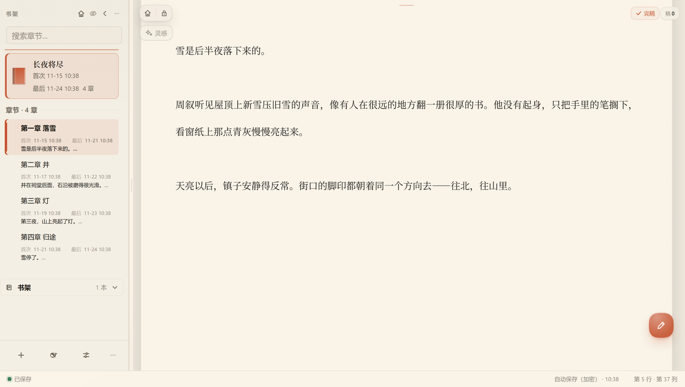

# 精神空间 · Mindspace

DeepSeek Harness 里的一体化小说写作插件：章节树、沉浸写作、AI建议与一键排版、
导入导出（txt / md / docx / epub / pdf）、投稿向导与期刊库、收件箱、加密本地存档。



## 功能

- **写作**：可折叠章节树、沉浸模式（`F11`、`Ctrl/⌘+Shift+F` 或 `Ctrl/⌘+Alt+F` 进出）、
  窗外下雨（真影像，可关）、写完一页自动摞到左边（可点回去）、打字机模式、粗光标、
  五套阅读主题、白天/黑夜；章节标题在稿纸上点一下就能改，首页「正在创作」直接标出正在写哪一章。
  默认只照亮**屏幕中间**那几行、上下其余淡去——**沉浸与非沉浸都一样**（书架开着时也一样，
  纱只盖纸面不盖桌面）。它锚在屏幕中间而不是跟着光标跑，所以一打开章节就到位；
  光标走出这条亮带时视口才轻轻挪一下，把它带回带子里。设置里可关，可调上下留几行。
  右下角一枚**写作工具圆钮**：收起时是一枚纸色圆盘——与四条菜单行同一张皮、一根
  发丝边、一点浮影，图标是墨色铅笔；只有悬停或展开时，笔尖才转成品牌红——静静贴在纸边；
  点开从上方长出**四个独立的按钮**（排版 / AI建议 / 读一遍 / 投稿），各是图标 + 完整名字，
  彼此之间留着 8px 的空、各长各的皮；悬停的那一枚铺一层品牌色薄雾。再点一次
  （或选中任一动作）就收回去。沉浸模式下更淡，但仍然在；「AI建议」也照常
  可用——坞里那一行、选字浮钮、Alt+A 和建议栏都在，栏和选中改写窗口会和正文并排。
  四个按钮就是四个按钮，不是一整块板：每枚自己的底是纸色只掺 4% 墨、边是一根
  55% 的发丝线、下面一点浮影；没有卡片、没有尖角、没有分隔线、行尾也没有箭头，
  按钮之间是真的空出来的纸。**每枚按钮只有自己的名字那么宽**，右缘对齐圆钮、
  左缘随字参差——它不该为了整齐而拉成一样长。
  四枚排成**从下往上的一级级台阶**：越靠上越长、也略高一点点，右缘一律齐着圆钮，
  左缘一级一级退出去；台阶的长短完全由那一行的名字决定，每一级留的余量都是同样多，
  谁也不多吃一口空白。名字从长到短往下排，所以顺序是 排版 → AI建议 → 读一遍 → 投稿：
  如果长度和台阶反着来，最长的那一级反而配最短的字，中间就会空出一大块。
  （R118 起 AI 校对并进了 AI建议，这一级台阶是四枚不是五枚。）
  图标各占一格 26px 的圆角小方块，悬停时和这一枚一起亮起来。
  那条 8px 的缝是**画出来的**（按钮的形状上下各内缩 4px），行盒子本身首尾相接——
  指针落在缝里时命中的仍是相邻的按钮，不会掉进一个没反应的空档。
  整条坞没有任何「自己不属于按钮」的像素：容器不带内边距、不留行距、不画底色和描边，
  圆的形状、行的胶囊全部由按钮自己的伪元素画出来。这一点是被反复咬过的——容器只要有
  一圈属于它自己的内边距，鼠标停在那圈上就是箭头、点击也会被吞掉。没有开章时这些
  动作不会「静默失效」——点下去会明确告诉你「先打开一章」，而不是一声不响。
  如果哪天它又「点不动」，先看看屏幕右下角有没有别的程序的**置顶悬浮球**（托盘助手、
  下载工具、加速球）：那种球浮在整个桌面上，会先把光标和点击接走，插件这边的 CSS 再
  怎么改都赢不了。这不是假设——曾经有整整五轮修在这里空转，最后是用户在桌面上同一
  位置点出那颗球的菜单才真相大白。
- **读一遍**：把整本书铺成书页——没有光标、没有工具栏，方向键 / 滚轮 / 点左右半页翻页，
  `Esc` 回到刚才那一句。字号行高主题跟着写作设置走，版面容得下多少字就排多少页，不预设分页。
  **点开就读**：点「读一遍」的那一刻就向浏览器要全屏——书桌铺满整块屏幕（宿主外壳的侧栏、
  工具条、状态栏一概让位），关卷时自动退出全屏、原样还回去，不改变编辑器的布局，也不改宿主窗口。
  环境不给浏览器全屏时，仍然铺满插件自己的视口，不会只剩下一条窄栏。
  **一屏两页、每页两栏**：宽屏一律摊开左右两页、每页再排两栏，1280 的屏幕上就是四栏
  （四栏各约 12–20 字，整屏 1920 时每栏 20 字）；窗口不够宽时按「两页两栏 → 一页两栏 →
  两页一栏 → 一页一栏」逐档退回，不需要手动切换，设置里也能锁成「一栏」。四档的顺序是
  「舒服」优先，不是先把宽度填满。
  **对开门槛**：可用宽度 ≥840px 就左右各一页、中间一道装订线，像摊开的书；四栏对开
  要 4×240 + 3×48 = 1104px 起，每栏最少 12 字——四栏是摊开的书，栏短一点反而像书页边注。
  R118 起版式按期刊排：纸面垫在一层略深的桌面上，对开时中缝只有一道书脊暗影（不画实线），
  栏与栏之间留空、不画栏线；纸面上沿一条跟随当前章的**眉题**（左页书名、右页章名，与各自那栏正文等宽，
  细线从外侧起笔、往书脊方向淡出），
  下沿是**页脚页码**（页码在外侧、书名/章名在里侧）；每章开头是「第 X 章」小字 → 章名 → 一条短线加菱形，
  首段不缩进、首字下沉三行，第二段起照常缩进 2em；正文用衬线字体、两端对齐，标注仍是页边的小签。
  纸是**桌上的一件东西**，不是铺满屏幕的一块底色：四周留着一圈桌面（上下各缩进 18px，
  天头 46px、地脚 40px），桌面左上有一盏灯、四角压暗，纸面带着和写作页同一种纸纹。
  顶纸下面是一整摞有体积的纸：下沿露出 13px，左右书口各探出 8px；两侧沿纵向椭圆微微鼓出，
  纸线稀而淡，书脊向下压暗，近处接触影与远处落影分开，不会像金属包边或悬浮的卡片。夜间另用暗纸切面。
  掀起来的那张纸、以及被它掀走之前露出的半边旧页，用的都是同一张纸的材质——
  翻到一半不会看出是两张不同的材料。
  掀起来的也不是一条正文带，而是**整张纸**：纸一直长到上下纸沿，页码、书名/章名和天头眉题
  都印在纸里、跟着纸一起翻——纸举到半空时，页码不会留在被它盖住的台上。翻页是**正交投影**，
  纸在空中不会被放大约一成、比整本书还大；落回书页时四边与静态页重合，
  不会再在页内留一圈「内框」接缝。
  翻页是一整页手翻：正文从不横移，掀起来的那张纸印着**离开的那一页**，一整页约 **0.56 秒**——
  这张纸会一直转到**半圈**（180°）：向后翻时右页转过去落在左页上、把它盖住，向前翻时反过来
  是左页落到右页上；翻过竖直之后露出来的是纸背，纸背上印的正是**落点那一侧的那一页**，所以盖下来
  的那一瞬没有一帧能看到两层字。
  弧度是「刚体平面 + 四层纸感」：正面由纸白渐到暗边、背面一道更深的暗边，宽窄跟着
  `sin(角度)` 走；纸的自由边不再是刀切的一条直线，而是一道 `clip-path` 椭圆裁出来的弧
  （中段外鼓、上下角收回，一个字都不切）；弧上叠三层 40px 卷边、纸面再压一道横跨
  「折痕 → 自由边」的明暗，纸转起来不是一块平色；底下那道落影是贴着自由边走的接触影，
  纸越侧过去越散越浅。纸转到与视线共面时投影为零，那里由不参与旋转的 `.nw-read-edge`
  补一道 2px 切口（67.5°–112.5° 之间淡入淡出），纸不会凭空消失。
  **页码与字体跟着设置走**：页脚页码按单页计数（跨页时左页 `i+1`、右页 `i+2`，末页右侧留白），
  正文用的是设置里那个 `fontFamily`（写单个字体名会自动加引号并补宋体兜底，写整条字体栈则原样用）。
  **设置 → 外观 → 字体**是一排用各自字体画出来的按钮：宋体 / 书宋 / 楷体 / 仿宋 / 霞鹜文楷 /
  黑体 / 等宽，点之前就看得见字形，下面还有一行正文范例跟着变；存的是整条字体栈，
  编辑器与阅读页读同一个值。楷体、仿宋、书宋分别落在系统的 KaiTi、FangSong、STSong
  （华文宋体）上，装了方正书宋的机器会优先用自己那一套。

- **念给我听**：阅读页右上角一个喇叭，按下去从当前这页的第一段开始念，念到哪段那一段就
  淡淡亮一下，念到下一页纸自己翻过去；旁边的小三角调语速（0.8 / 1 / 1.2 / 1.5×）、引擎和音色。
  四种引擎，代价写在脸上：
  - **系统**（默认）：浏览器自带语音，零依赖、离线可用，正文一个字都不出本机；音色就是系统
    语音的水平，中文听感一般。
  - **微软**：Edge 读声那套中文自然音（晓晓、云希、云健…共十种，含台湾腔、粤语、东北腔），
    免费、不用密钥，**这一段正文会联网发给微软**。它是未公开的 WebSocket，个别网络会被直接
    拒掉（403）——真遇到就把引擎换成下面两个。
  - **百度**：`fanyi.baidu.com` 那个免费朗读，国内连得通、不用密钥，只有一个女声，清楚但不带
    感情；正文联网发给百度。
  - **自定义**：任何 OpenAI `/v1/audio/speech` 形状的接口——OpenAI 本体、各家云的中转、本地
    跑的 GPT-SoVITS / CosyVoice / Kokoro 都行。地址、密钥、模型、音色在「设置 → 阅读」里填，
    填到 `/v1` 就自动补 `/audio/speech`。填完就有一个「像真人」的引擎，质量取决于你接的那个。
  三种联网引擎都走宿主发出的请求（浏览器直连会被 CORS 和密钥挡下来），关掉阅读页一定停声。
  纸是一整片，弯的是光——书脊一侧压暗、中段透、自由边吃亮，随纸立起的程度一起浮现，
  桌上那页还会接下它的影子（纸立得越高，影越散越深）。拖拽能从纸边起手，松手时按剩下的角度接着翻完。
  读的时候可以选中一段字画下划线、删除线或写一条批注，写作时也看得见，改过字它也跟着走。
  **文字只属于批注**：下划线说「这句好」、删除线说「这句要删」，两条线都不带字；
  一旦给一条线写了字，它就是批注了（同一句话不会同时是下划线和批注）。反过来把批注的字删空，
  它退回一条下划线。
  带批注的那条线在**右侧页边**配一枚小签，和它指向的那一行齐平——小签在页边空白里，
  永远不压字；签上写着这一章的第几条批注，鼠标移上去、或点开它，它指的那句会明显亮起来，
  同一行挂两条也分得清谁是谁。对开两页时，左页的签在左边、右页的签在右边（各贴自己那页的
  外缘）；回到单页，所有签都回到右侧。
  点小签或点那条线本身，就在点击处旁边浮出一张小便签（下划线和删除线只有「删除」，
  批注直接展开原文就地改）。批注**没有保存键**：字打进去就存，停一下就落库，
  点别处（任何地方）、Esc、滚动、翻页都会收起并把最后一句补上。翻页不横移正文：整页在换页那一刻
  直接落位，掀起来的是一张**印着那页正文的纸**（正文后面藏着一份只读副本，掀页前先把它指到旧页，
  所以纸上的字与它原来所在的位置严丝合缝），整张纸绕中缝转到**半圈**落在对面那一页上，纸背印着
  落点那一侧的那一页，`rotateY` 只在合成层跑（`perspective: none`，正交投影），≈0.56 秒，
  所以永远看不到一页字从装订线上
  穿过去。掀页时副本里的章是冻住的（换章就要重排，纸上的字会跳），落定后窗口才平移；正文不再整页
  变暗，页边签也不跟着抖——它们等这一页落定后才重画。
  在纸边、桌面色或页眉页脚带上按住可以拖着走（正文上按住仍是选字），纸面最多转 26 度，松手时
  过了一页的 15%（或者手快）就顺着当前角度转完，否则直接收掉。
  写作面上不再新建标注：拖选、右键都不会弹「下划线 / 删除线 / 批注」。标注只在「读一遍」里做，
  写作面只负责**裁决**——点划过的字（或右键它），批注和删除线的卡片上只有**「接受」「拒绝」**两个
  按钮：接受批注就把那几句批注换成原文所在的字，接受删除线就把划掉的那几个字删掉，拒绝则原文一字
  不动；**无论接受还是拒绝，这条标注都会消失**，不会在纸面上留痕。点一下就落库，`Ctrl+Z` 还能撤回
  这次改字。下划线没有「改哪儿」的语义，卡片上仍只有一个「删除」。要改批注内容、要新划一条，回
  「读一遍」里改——编辑页不再提供修改批注的入口。同一段字只会有一条标注。
- **低摩擦启动**：首页第一行是**继续写**——回到上次那一章、落在上次停笔的那一句。
  「今天」是一个可点的目标环（默认 500 字，点一下改），状态栏同步显示「今日 +N / 500 字」。
- **写作面的光**：编辑时有一小片暖光跟着光标那一行走，打字时亮，停笔两秒降到四成——像一盏
  只照着你正在写的这一行的台灯；夜盘里它是冷一点的月光，而且更暗。重开一章、光标落回上次停笔
  那一句时，纸的右缘会折起一个小角，敲下第一个字（或过六秒）就展平，等于替你在稿纸上做了个记号。
- **进度与设定**：状态栏带「今日 +N 字 · 连续 N 天」；目录树每章可标「修改中 / 已定稿」，
  设了目标字数就显示「1200/3000」、达标转绿；**每章名字下方**都有一行 11px 小字，显示首次/最后编辑时间
  和正文开头一两句（栏宽时时间带年份、摘要两行，栏窄时自动缩写收成一行；时间行更小更淡，摘要用正文色；
  旧章没有首次记录时按今年 1 月 1 日显示，只是打开章节不会刷新「最后编辑」）；右键「章节信息」改状态、一句话简介与目标；
  书的「⋯」菜单里是**设定集**
  （人物 / 地点 / 道具 / 设定，按书存），只给自己看，不进正文、不进导出。
- **版本**：每次切换章节或手动快照留一版，可以「对比当前」逐行看差异（增删高亮 + ±行数）再决定恢复。
- **外观**：五套主题——浅色 / 护眼 / 深色 / 报纸 / 杂志。可以**跟随系统深浅色**：系统切到深色时
  用你选的那套；系统切到浅色时，从浅色 / 护眼 / 报纸 / 杂志里随机抽一套，进入浅色立刻换一次，
  之后每半小时再换一套，不再需要单独的「浅色随机」开关。换的时候纸色、墨色、边影一起
  用 1.2 秒慢慢过去，像是屋里的光换了，不是换了一张皮；手动点主题仍然是一下就换。
  锁屏也住在这套主题里：白纸是书房、夜里是台灯；设置里可把锁屏固定成深色。
  锁屏的小图标是专门画的——开卷书签、带弧梁的小锁、SVG 箭头；忙碌时箭头变成一枚细旋转环。深色（night）的强调色是暖铜，
  不再用蓝色，和台灯、纸色放在一起更顺。
- **AI**：AI建议逐条指出问题（错别字与标点也在其中）；一键排版；模型选择与自动回退。
- **AI建议**：右下角坞里的那一栏通读整章，指出最值得改的地方（角度**可多选、也可以不选**——
  选了几颗就只看那几个角度，一颗不选就按输入框里的要求来；点角度只是改选择、不会开跑，
  选好了再点「开始审读」；**卡片边读边出现**，不必等整次请求结束）；
  角度里有专门的**字词与标点**：错别字、同音形近误用、重复字、标点与搭配错误、明显的病句，
  只报确凿的错，不改风格、不把方言口语和「换个词更好」算成错（R118 把原来单列的 AI 校对并进了这里，
  坞里不再有第二个按钮、设置里也不再有一套校对的模型与要求）；
  **选中一段字**还会在指针旁边浮出一枚小钮，点开在正文右侧并排开一扇窗口，只针对这几个字给出**能直接
  替换的改法**——原文和改后左右对照（并逐字标出删了哪几个字、补了哪几个字），不用选模型、不用选角度；
  卡片一条条流式出现，不用等整段。每条下面有 **复制 / 替换到正文 / 再改一版**：替换是真正写进稿子、
  并且能一键撤销；「再改一版」把刚读到的那一版发回去，要一版明显不同的，可以一路迭代到满意。
  每条还能接受或拒绝；**接受只记账、不会替你改正文**，接受成功就从待处理列表移走、出现在
  下方「已接收」里（同一个地方改过两次以上会归成一组、用 ① ② ③ 标出先后），拒绝的直接丢弃。
  点「已接收」里任何一条，正文里对应那句会滚到视线中间并高亮；同一段字再打开**不会重复计费**
  （结果缓存在本地，页脚会标「上次的结果」）。
  栏底还有 **粘贴其他 AI 的建议**：把面板里给的格式（原文 / 问题 / 理由 / 建议 / 改后，或一个 JSON 数组）
  贴进来，导入的卡片与模型给出的完全同构——同样高亮、接受 / 拒绝、复制 / 替换 / 撤销；原文按当前章节
  定位，找不到的会标「定位不到」，不会乱指。点「复制全文与全部问题」会连**本章全文和已有问题**一起复制，
  直接发给另一个 AI 即可；桌面版由宿主直接写入系统剪贴板，不依赖浏览器权限。
  这些记录存在本机 IndexedDB，随备份走，不上传。
- **稿件**：导入 txt / md / docx / epub 自动分章；导出 txt / md / docx / epub / pdf。
- **投稿**：三步投稿向导，内置 79 家文学期刊库（可增删改），按体裁/字数/风格推荐；
  投稿记录跟着书走，改名后显示「现名（投稿时：旧名）」。
- **邮件**：SMTP 发信、IMAP 收件箱，直接在插件里读投稿回信。默认要求 TLS 并校验证书；
  证书校验失败或服务器不提供 STARTTLS 时会中止（避免授权码被中间人截走），
  确认是公司代理 / 可信内网中继时，可在设置里打开两个标着「不推荐」的开关。
- **存档**：本地 IndexedDB + 可选加密（PBKDF2 + AES-256-GCM），版本历史与回收站；
  保存到文件夹时书名改动会覆盖旧文件，不会越攒越多；**只重写改动过的那几本书**，
  一百本书也不会每次空闲都写一遍。文件夹快照里带着书、便签、**标注、设定集、已接收建议**与
  投稿记录；**恢复不会清空快照里没有的数据**（版本历史与回收站原样保留），
  要把它们搬到另一台机器请用设置里的「导出 JSON / 恢复」。
  **重装宿主也不会再丢密码与设置**：密码的校验值、主题字号与面板布局会被备份在
  `DSH_HOME/novel-writer/client-state.json`（不含密码本身），下次打开只要重输一遍密码即可解锁。

- **窗外的雨**：写作页的底是一条窗——外面下雨、有树、有风。两层真影像叠起来：远处一层是雨中的
  树林（略微提亮、加饱和），近处一层是玻璃上滑落的水珠（`mix-blend-mode:screen`，只留水滴）。
  底下是冷石板桌面：右上角一盏没入画的灯留下暖光池，纸边搁着一支笔、一杯没喝完的茶。
  两段 mp4 随仓库走（`assets/rain-forest.mp4`、`assets/rain-window.mp4`；Mixkit #6890 与
  Pexels #30641043，裁 1280×720、24fps、乒乓循环），由宿主
  `GET /novel-writer/api/scene.forest|scene.video` 边下边播（支持 Range/206），不进 bundle；
  取不到时自动退回程序画的窗外，断网也照常写字。设置 → 外观 → 「窗外的雨」可关，关掉就是一张白纸。
- **写完一页，摞一页**：纸不动、字往上走；一页写满、彻底滚出纸面，那一页就**落到左边摞起来**——
  卡片上是那一页的原文，页脚带页码，最新那张落下时有一点落纸的动势。往回滚、或点其中一张，
  那一页就**回到纸上**（平滑滚回该页页首），摞里同时少一张。页是按版式量出来的：
  `pageH = 行数 × 行高`（行数取自纸的可视高度），边界靠一个同字体同宽的隐藏镜面 + `Range` 逐行
  二分，所以换字体、改字号、改纸宽都会重算，不是按字数估的。摞最多摆 8 张，窄栏自动收起。
- **外观**：界面按「一张纸放在一张桌上」来搭。写作面板的底是掺了 5% 墨的桌面，纸是单独一层：
  自带细噪点纹理、上缘一道受光的亮边、下面一层落影（栏宽够时才投，窄栏不出现光晕）。
  全站的分区标题统一成一支笔的短线——18×2 或 30×1 的暗红，不再有竖条、横杠、渐变三种画法混着用；
  弹窗顶上是一条 34px 的短红线，而不是横贯整个弹窗的色带。首页只有「继续写」一个主行动，
  统计是灰色托盘上的白纸片，今日目标环达标时变绿；书架上的书封有书脊、纸口和一点点倾角；
  开关的滑块是白的、轨道有内阴影；AI建议里「原文 / 改后」是两张等高、各带一条色边的纸片，
  措辞只改字、不动正文。锁屏是唯一手绘的一块：书房、台灯、一排书脊。
  这些都在 `client/src/98c-signature.js` 一个文件里，排在所有样式之后，不靠 `!important` 赢。

## 安装

插件包目录即仓库根。在 DSH 里执行：

```
plugin_manager action=install_bundle target=<本仓库绝对路径>
```

安装后左侧栏出现书本图标，点击进入「精神空间」主面板。校验 Host 是否就绪
（`dsh web` 的端口每次启动都会变）：

```bash
curl http://127.0.0.1:<web端口>/novel-writer/api/ping
# {"ok":true,"data":{"name":"novel-writer","version":"1.9.0",...}}
```

改 Host 代码后要**重载插件**（Node 模块已缓存）：

```
plugin_manager action=set_plugin target=include:novel-writer enabled=false
plugin_manager action=set_plugin target=include:novel-writer enabled=true
```

只改客户端则重建产物，刷新页面即可：

```bash
node scripts/build-client.mjs    # client/src/*.js → client/client.js（含加载闸门）
```

## 开发

```bash
node scripts/verify-host.mjs     # 离线宿主测试（不需要运行中的 DSH）
node scripts/verify-docs.mjs     # 导入导出与 docx/epub 排版断言
```

- 运行时零第三方依赖：Host 只用 Node 内置模块，Client 只用宿主提供的 `react` 与主题 token。
- 入口：`index.js`（Host）+ `client/client.js`（浏览器，由 `client/src/*.js` 按文件名拼接）。
- 接口：`/novel-writer/api/*`，统一 `{ok, data|error}`，方法表见 `docs/CONTRACT.md`。
- 目录说明与逐轮改动记录见 [`docs/CHANGELOG.md`](docs/CHANGELOG.md)。

## 提交与发布

每次 `git commit` 后自动上传到 GitHub（`.githooks/post-commit` → `tools/auto-push.mjs`），
失败会重试并记在 `.tools/push.log`。配置见 `docs/CHANGELOG.md` 的「上传到 GitHub」一节。

## 许可

Copyright (C) 2025 Jokii-Joy

本项目以 **GNU General Public License v3.0 or later** 发布，全文见 [LICENSE](LICENSE)。
你可以自由使用、修改和分发；分发修改后的版本时须同样以 GPL-3.0-or-later 开放源代码，
并保留版权声明。本程序不提供任何担保。
