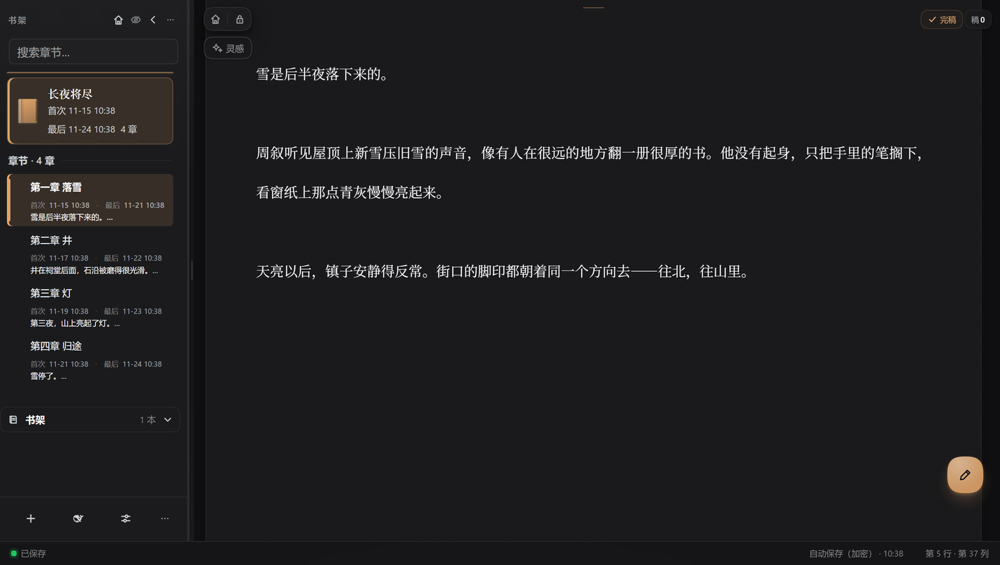
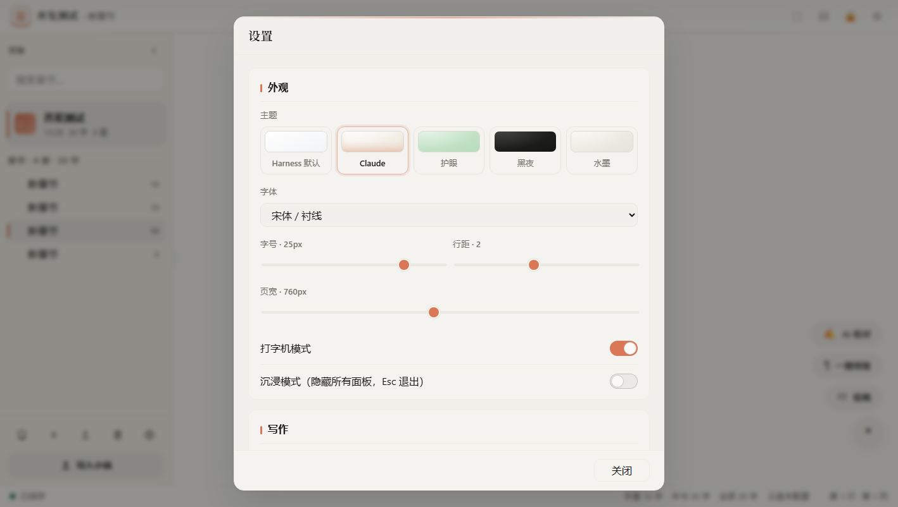
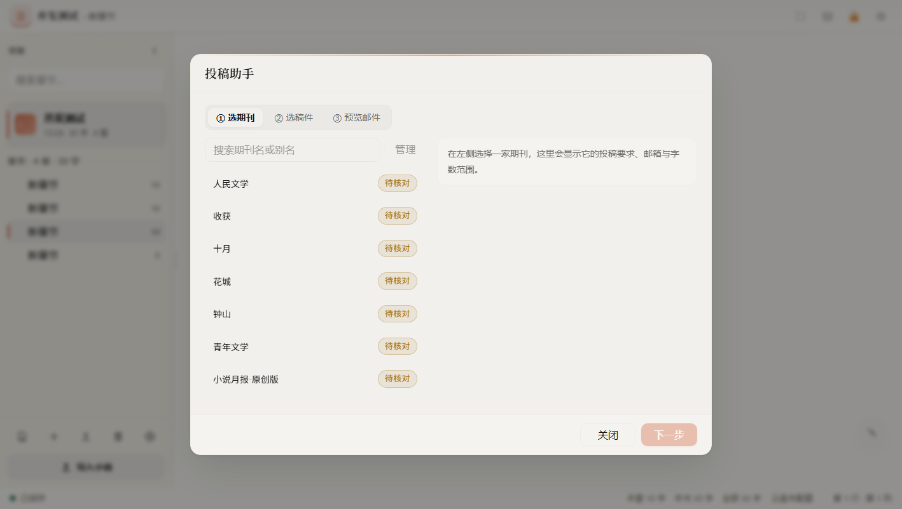
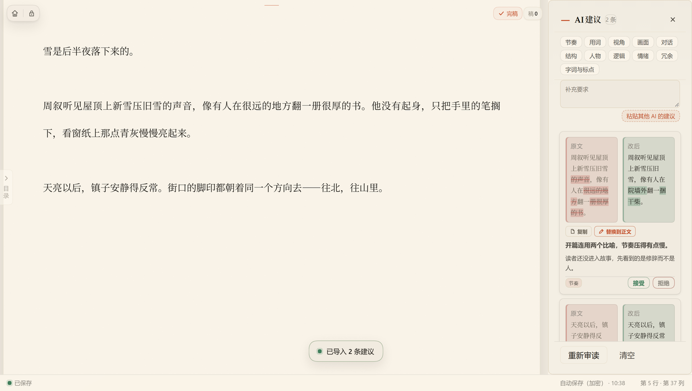
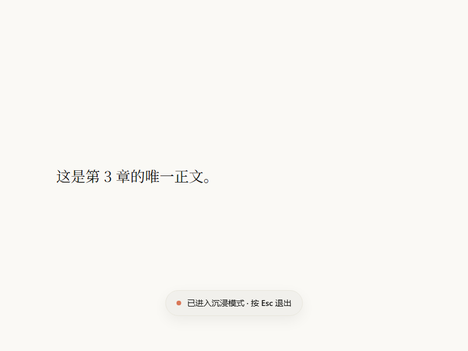

<div align="center">


# 精神空间 · Mindspace

**从第一句到投稿箱，一张纸就够了。**

[](docs/CHANGELOG.md)
[](LICENSE)
[](https://github.com/deepseek-ai)
[](package.json)

一个跑在 [DeepSeek Harness](https://github.com/deepseek-ai) 里的沉浸式小说写作工作台。
章节树、沉浸编辑、AI 建议、一键排版、导入导出、投稿向导与加密存档，全部收在一张纸上。
数据只留在本机。

[功能](#功能) · [截图](#截图) · [快速开始](#快速开始) · [使用](#使用) · [开发](#开发) · [开发日志](docs/CHANGELOG.md)

</div>


## 为什么

写作软件要么把界面做成后台系统，要么把改稿和投稿丢给别的工具。精神空间只做一件事：
让「写 → 改 → 排版 → 投出去」留在同一个安静的地方，不打断。

- **本地优先**：正文存在浏览器 IndexedDB，可加密；镜像备份落在你自己的文件夹。
- **零运行时依赖**：Host 只用 Node 内置模块，Client 只用宿主提供的 React。
- **不联网也能写**：AI、投稿、收件箱是可选能力，关掉不影响写作。

## 功能

**写作**
- 可折叠章节树，拖拽排序，卷 / 章两级目录
- 沉浸模式（`F11`、`Ctrl/⌘ Shift F` 或 `Ctrl/⌘ Alt F`），打字机模式，粗光标，页面宽度可调
- 五套阅读主题：羊皮纸 / 护眼 / 夜间 / 报纸 / 杂志，可跟随系统深浅色
- 每天的写作目标环，字数统计，章节状态（构思 / 起草 / 修改 / 完稿）

**改稿**
- AI 建议面板：通读整章、按角度提修改建议，接受 / 拒绝 / 逐条定位
- 选中文字直接问 AI，建议以卡片并排显示，改动前自动留版本
- 版本历史与差异对照，任意一版都能恢复

**成书**
- 一键排版：标点、空行、缩进按规则批量整理
- 导入 `txt` / `md` / `docx` / `epub`，导出 `txt` / `md` / `docx` / `epub` / `pdf`
- 完稿封存：把某一版固定为付印稿，导出和投稿都以它为准

**投稿**
- 期刊库：征稿要求、体裁、字数、收稿邮箱一目了然，支持批量导入与自定义
- 投稿向导：按期刊要求生成投稿信、正文与附件，SMTP 直发
- IMAP 收件箱：编辑部回信直接进插件，按投稿记录归档

**数据**
- AES-256-GCM 加密 + PBKDF2（210,000 次），锁屏保护
- 本地自动保存、备份文件夹镜像、从备份一键恢复
- 摸鱼模式：桌面版弹出 Windows 原生稿纸条（仿宋三号、三行、640×97.5），浏览器里用画中画

## 截图

| 编辑器 | 夜间 |
| :-: | :-: |
|  |  |

| 设置 | 投稿 |
| :-: | :-: |
|  |  |

| AI 建议 | 沉浸模式 |
| :-: | :-: |
|  |  |

## 快速开始

**环境**：DeepSeek Harness（桌面版或 `dsh web`）。

1. 获取仓库并放进插件目录：

   ```bash
   git clone https://github.com/Jokii-Joy/novel-writer.git
   ```

2. 在 DSH 的插件管理里启用 `@local/novel-writer`（仓库自带 `cordis.patch.yml`，会插入
   `novel-writer` 层）。

3. 重载 DSH。左侧栏出现书本图标，点开就是精神空间。

> 首次打开是空书架。点「新建小说」写第一行，或把已有的 `txt` / `md` / `docx` / `epub` 拖进来。

## 使用

- **新建 / 导入**：书架页新建小说，或导入现成稿件，自动按标题拆章。
- **写作**：左侧目录选章，正文直接写；`F11` 进沉浸模式，`Esc` 退出。
- **AI 建议**：工具坞点「AI建议」，或选中文字后按 `Alt+A`。
- **导出 / 投稿**：工具坞「排版」「投稿」；投稿前先在设置里配好 SMTP，收信再配 IMAP。
- **备份**：设置 → 导出与文件 → 备份，选一个文件夹即可自动镜像；恢复时选 `.nwe` / `.json`。

快捷键：`Ctrl/⌘ S` 保存，`Ctrl/⌘ F` 查找，`Tab` 缩进，`Alt+A` AI 建议。

## 开发

```bash
npm run build    # client/src/*.js → client/client.js（按文件名顺序拼接）
```

构建脚本会顺带跑一组回归自检（加载、异步守卫、加密恢复等）。也可以单独执行：

```bash
node scripts/verify-client-load.mjs client/client.js
node scripts/smoke-app-render.mjs
node scripts/verify-lock-screen.mjs
node scripts/verify-advice-ui.mjs
```

目录：

```
client/src/     客户端源码（按文件名拼成 client.js）
client/client.js 构建产物，勿手改
lib/            Host 侧：AI、导入导出、排版、SMTP/IMAP、加密、摸鱼
scripts/        构建与验收脚本
docs/           开发日志、接口契约、截图
locale/         中英文案
```

技术要点：双半插件（Host + Client），Client 直接渲染进宿主中央面板；正文用 IndexedDB
存加密片段；AI 与邮件走 Host 路由，浏览器不直接持有凭据。

## 文档

- [开发日志](docs/CHANGELOG.md) — 逐轮改造记录与验收数据
- [接口契约](docs/CONTRACT.md) — Host / Client 的边界与消息格式

## 许可

[GPL-3.0-or-later](LICENSE)。
